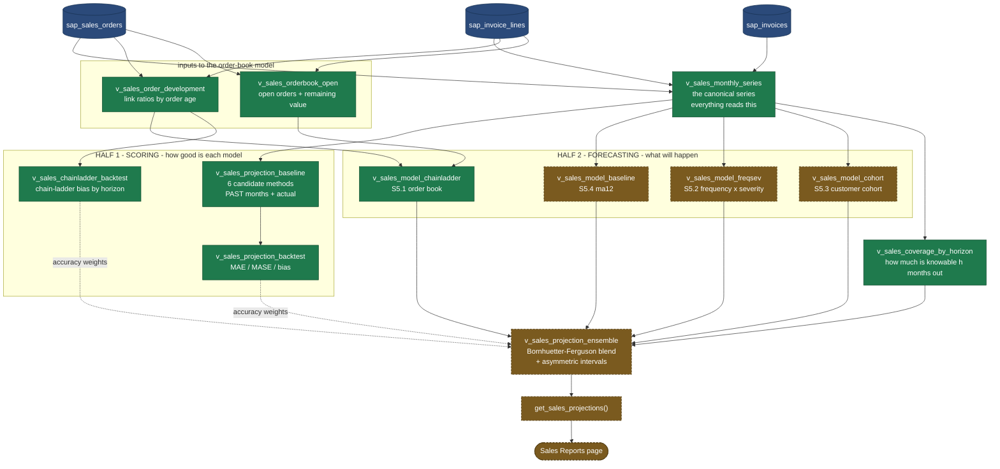

# Sales Projections Architecture — Ensemble Model

**Status: designed 2026-10-02, not built.** This is v2. The original design — a single seasonal-decomposition model on its own page — was tested and dropped; §11b records why, §11c the reframe. Sections 1–10 below are the replacement design. Sections 11–11d are the evidence that produced it, and should be read first by anyone questioning the choices here.

**Execution state and build order live in [`docs/setup/SALES-PROJECTIONS-DEPLOYMENT-GUIDE.md`](../setup/SALES-PROJECTIONS-DEPLOYMENT-GUIDE.md).** This document is the design.

---

## 0. How this works — read this first

### The system has two halves

Everything in this document belongs to one of two jobs. Keeping them apart is
the key to understanding the file list.

**HALF 1 — SCORING. Looks backward. "How good is each model?"**
Take a month that has already closed. Ask each model what it *would* have
predicted, without letting it see the answer. Compare against what actually
happened. The output is accuracy numbers.

**HALF 2 — FORECASTING. Looks forward. "What will happen?"**
Each model predicts future months. Blend them into one number, weighting each
model by how accurate Half 1 proved it to be. The output is what reaches the
dashboard.

Half 1 exists so that no model ever reaches a dashboard on intuition. It is how
Engine A was dropped (§11b) and how the chain-ladder earned its place (§11e).

### Why some views look like near-duplicates

Because a model that predicts the *past* and a model that predicts the *future*
are different queries, even when the method is identical.

`v_sales_projection_baseline` predicts closed months so it can be scored, so it
carries an `actual` column:

| period_month | horizon | method | predicted | actual |
| --- | --- | --- | --- | --- |
| 2026-09 | 1 | ma12 | 3.1M | 2.3M |
| 2026-09 | 1 | seasonal_naive | 5.8M | 2.3M |

`v_sales_model_chainladder` predicts future months so it can be shown, and
there is no actual to carry:

| period_month | horizon | model | predicted | variance |
| --- | --- | --- | --- | --- |
| 2026-11 | 1 | chainladder | 4.45M | … |

Same idea, two shapes, two purposes. **The practical consequence right now:
`ma12` only exists in backward-looking form.** Nothing yet says what `ma12`
predicts for November 2026, and the ensemble needs a forward prediction from
every model. Building that forward twin is Phase B, not a rewrite — the
scoring view stays exactly as it is.

### The whole picture



Green is built. Amber dashed is not built yet. Blue is SAP data that already
arrives through the pipeline.

### What exists today, in plain terms

| Thing | Built? | What it does |
| --- | --- | --- |
| The canonical series | ✅ | One agreed definition of monthly revenue, used by everything |
| The scoring harness | ✅ | Proves whether a model is any good before it ships |
| Order-book model (§5.1) | ✅ | Projects invoicing from orders already placed. Owns 59% of next month |
| `coverage(h)` | ✅ | Measures how much of a month is knowable *h* months ahead — drives the blend |
| Seasonal decomposition | ⚪ | **Retired.** Lost the bake-off; kept as the evidence for why |
| Baseline `ma12` forward | ⬜ | **Phase B** |
| Frequency × Severity | ⬜ | **Phase B** — supplies the honest, asymmetric uncertainty |
| Customer cohort | ⬜ | Phase F — the only model reaching the 28% with no sales order |
| The blend | ⬜ | Phase C |
| RPC + dashboard | ⬜ | Phase D |

**Two of four models built. Shared plumbing done. Scoring harness done.**
Four files stand between here and a number on a screen: two in Phase B, the
blend in Phase C, the RPC in Phase D.

---

## 1. What this is, in one paragraph

A forward projection of monthly invoiced revenue, 1–12 months ahead, produced by **four independent models blended into one number with an honest uncertainty range**. No single method is trusted. Near-term the blend leans on orders already booked; further out it leans on statistical expectation, with the transition governed by how much is actually observable at that horizon rather than by an arbitrary cutoff. Every component is visible on the dashboard, so the number can be challenged rather than merely believed.

It is **purely informational** — no targets are set from it, nobody is measured against it, and there is no human override. That is a deliberate scope choice (confirmed 2026-10-02) and it removes the need for an approval workflow or an adjustment audit trail.

---

## 2. Why an ensemble, and not a better single model

Three findings from Steps 1–5 forced this shape. Each is measured, not assumed.

**Revenue cannot be extrapolated from its own history.** Six methods were backtested over 106 rolling origins (§11b). The winner was a plain 12-month moving average, at a 37.6% average absolute error — roughly 70% against 2026's smaller months. The seasonal model this project was originally built around came fourth. There is one reliable seasonal month out of twelve.

**But most of a month is already observable.** About 60% of invoiced value in any month was already sitting in the order book when the month began (§11d). That is fact, not extrapolation, and a time-series model throws all of it away.

**And no single source covers the whole picture.** The order book reaches about four months and misses the 27.4% of revenue invoiced with no sales order at all. Statistical methods cover every horizon but carry large error. Customer history explains repeat business the order book never sees.

Forecast combination reducing error is one of the most replicated results in the forecasting literature, and the **disagreement between methods is itself information**: when four independent approaches converge the interval is tight; when they diverge the number is genuinely uncertain and should say so.

**What an ensemble will not do** is manufacture signal that is not there. Expect meaningfully better than 37.6% for next month — plausibly 15–25% — and materially worse as the horizon extends. Anyone promising a few percent on a tender-driven series is wrong.

---

## 3. Vocabulary — four forward-looking numbers, never blended

Extends `DASHBOARD-CONVENTIONS.md`'s canonical tag table. All four may appear on Sales Reports; none is ever reconciled into another.

| Tag                    | Source             | Nature                          | Who sets it       |
| ---------------------- | ------------------ | ------------------------------- | ----------------- |
| **Target**             | `sales_targets`    | CRM quota per rep/month         | A human           |
| **Budget**             | `sales_budgets`    | SAP-invoice quota per rep/month | A human           |
| **Order Book**         | `sap_sales_orders` | Committed, not yet invoiced     | A customer        |
| **Projection** _(new)_ | the ensemble       | Statistical, with an interval   | Nobody — computed |

The existing rule stands: two figures may legitimately disagree; label both sides so the difference is visible, never silently pick one or blend them.

---

## 4. The measure

**Monthly invoiced revenue** (`sap_invoices`, `is_cancelled = 'N'`, `total_amount_myr`, dated by `invoice_date::date`) is the only measure projected in v2.

Orders and collections remain in `v_sales_monthly_series` because the models read them as inputs, but they are not themselves projected. Scope discipline: one number done properly beats three done partially.

---

## 5. The models

Four active, one reserved. Each is an independent view producing `(period_month, horizon, model, predicted, variance)`.

### 5.1 Chain-ladder on the order book — horizons 1–4

The actuarial run-off triangle, applied to orders instead of claims.

Every open order has an age and a remaining uninvoiced value. History tells us what fraction of an order's value converts at each month of age (Q4):

| Lag | Converts | Cumulative |
| --- | -------- | ---------- |
| 0   | 17.0%    | 17%        |
| 1   | 28.6%    | 46%        |
| 2   | 14.4%    | 60%        |
| 3–4 | 19.4%    | 80%        |
| 5–7 | 11.5%    | 91%        |

For an order of age _a_ with remaining value _R_, expected conversion next month is `R × f(a+1) ÷ (1 − F(a))` — the standard conditional development factor: the share of what has _not yet_ converted that converts next.

**Remaining value** comes from `sap_sales_orders_with_fulfillment.total_invoiced_myr` against `total_amount_myr`. ⚠️ That column sums _whole invoices_ per order, so if one invoice draws on several orders it will over-count. **Verify at line level before relying on it** — if it over-counts, compute remaining from `sap_invoice_lines` where `base_type = 17` instead.

**`delivery_date` is deliberately unused.** 90.6% of the open book is past its delivery date, 56.9% by more than 90 days (Q6). Those dates are not maintained; age-based development is the only reliable timing signal.

### 5.2 Frequency × Severity — all horizons

The collective risk model, and the piece that makes the intervals honest.

Monthly invoice **count** is stable (82–131). Invoice **values** are wildly volatile. Modelling total revenue directly blends a predictable signal with a noisy one and loses both. Split them:

```
E[Revenue]   = E[N] × E[X]
Var[Revenue] = E[N]·Var[X] + Var[N]·E[X]²
```

Closed-form, so it runs in SQL with no simulation. `N` from a trailing count mean; `X` mean and variance from trailing invoice values.

This matters beyond tidiness: it produces an **asymmetric** interval. Downside is bounded — revenue cannot fall far below the committed order book — while upside is a fat tail, because one large tender can land. A symmetric ±band misrepresents that. It also makes the interval widen _for the right reason_: when a month depends on a few large invoices, which is the real business risk.

### 5.3 Customer cohort — horizons 3–12

Retention × frequency × spend over 108 months of purchase history.

> Of customers who bought in the last 12 months, what share buy again in a given month, how often, and for how much?

`E[revenue] = Σ over active customers of P(purchases in month) × E[spend | purchase]`

**This is the only model that reaches the 27.4% of revenue with no sales order behind it.** That is almost certainly repeat customers reordering informally — a retention problem, not a pipeline problem. Grouped by customer segment rather than individual customer, to avoid fitting noise on small accounts.

### 5.4 Statistical baseline — all horizons

`ma12`, the trailing 12-month mean. Won the Step 4 bake-off (MASE 0.760 at horizon 1, 0.811 at horizon 3, best on all three measures).

Its job in the ensemble is to catch whatever the structural models miss, and to anchor long horizons where the order book is empty. Already built and validated in `v_sales_projection_baseline`.

### 5.5 Pipeline conversion — reserved, weight ≈ 0

`sales_leads` weighted by calibrated win rates.

**Not weighted at launch.** `sales_leads` has roughly two months of history and a sales cycle longer than that, so almost nothing has closed — there is nothing to calibrate against, and an uncalibrated pipeline model imports self-reported optimism directly into the forecast.

Its weight is **computed from the volume of closed leads in the calibration window**, so it rises on its own as history accumulates. No redesign, no code change. The dashboard shows it honestly: _"Pipeline: insufficient history (2 months) — weight 0%."_

---

## 6. Combination — Bornhuetter-Ferguson credibility

The models are not averaged. They are blended by **how much is actually known at that horizon**, which is the Bornhuetter-Ferguson mechanism.

```
Projection(m, h) = OrderBook(m) + (1 − coverage(h)) × APriori(m, h)
```

- **`OrderBook(m)`** — §5.1's chain-ladder estimate. Zero beyond about four months.
- **`coverage(h)`** — the historically measured share of a month's invoicing already in the book _h_ months ahead. Measured, not chosen. At h=1 it is ~60% (§11d); it decays toward 0 as _h_ grows.
- **`APriori(m, h)`** — the blend of §5.2–5.4, weighted by inverse historical MAE from the backtest, floored so no single model dominates.

This gives exactly the behaviour the business needs without arbitrary switching: next month leans on committed orders, month nine leans on statistical expectation, and the transition is smooth and justified.

**Each horizon gets its own `coverage(h)`**, measured the same way Q3 measured h=0. That measurement is a prerequisite, not an assumption.

---

## 7. Uncertainty

Total variance decomposes into two sources, reported separately because they mean different things:

| Source            | What it is                                                            | What a large value means                        |
| ----------------- | --------------------------------------------------------------------- | ----------------------------------------------- |
| **Within-model**  | §5.2's `Var[Revenue]`, plus each model's historical residual variance | The business is inherently lumpy this month     |
| **Between-model** | Variance of the models' point estimates around the blend              | The methods disagree — the situation is unusual |

`Total = within + between`. Intervals at 80% and 95% from a gamma or lognormal matched to the blended mean and variance — **not a normal**, because the distribution is right-skewed by the fat upper tail.

**Between-model spread is surfaced as its own KPI.** Tight agreement is evidence; wide disagreement is a warning. Hiding it behind a single confident number would be the dishonest choice.

---

## 8. Object inventory

Every file and view in this feature, what it is for, and whether it feeds the
forecast. All in `hyrax-central-portal`; all views are `security_invoker = on`;
all SQL is hand-pasted into the Supabase SQL editor.

**Statuses:** ✅ built and in use · 🔵 scoring harness (validates models, never
produces a published number) · ⚪ evidence only (settled a decision, retained as
the record) · ⬜ not built yet.

### 8.1 Shared input — read by everything

| File | View | Status | Why it exists |
|---|---|---|---|
| `sql_editor/sales_projection_series_view.sql` | `v_sales_monthly_series` | ✅ | The canonical monthly series for all three measures. Filters copied verbatim from `base_invoices`/`base_orders`/`base_payment_apps` in `get_sales_reports_dashboard_rpc.sql`, so the projection can never disagree with the actuals tile above it. Carries a `generate_series` spine (a missing month would silently shift every `lag(value, 12)`) and an `is_complete` flag (the current month is always partial). **Every other view here reads this one.** |

### 8.2 The models

Each produces, or will produce, `(period_month, horizon, model, predicted, variance)`.

| File | View | Model | Status | Why it exists |
|---|---|---|---|---|
| `sql_editor/sales_order_development_view.sql` | `v_sales_order_development` | — *(input to §5.1)* | ✅ | Chain-ladder **link ratios**: of order value still outstanding at age *a*, what share converts at *a+1*. Rebuilt 2026-10-02 from the original share-of-original formulation, which carried survivorship bias (§11e). `survival_log` supports the model's survival product. |
| `sql_editor/sales_orderbook_open_view.sql` | `v_sales_orderbook_open` | — *(input to §5.1)* | ✅ | Orders still carrying uninvoiced value, with age. Remaining value computed at **line level** — deliberately not `sap_sales_orders_with_fulfillment.total_invoiced_myr`, which over-states (see `DASHBOARD-ROADMAP.md` §4 Group C). "Open" means remaining value, not `status_code`, which Q6 showed is unmaintained. |
| `sql_editor/sales_model_chainladder_view.sql` | `v_sales_model_chainladder` | **§5.1 Chain-ladder** | ✅ | Expected invoicing from orders **already placed**. Owns 59.3% of next month, decaying to 16.3% by month six. Unbiased from h=3, +14% at h=1 (§11e). Cannot see unwon business or the 28% with no order — by design. |
| `sql_editor/sales_projection_baseline_view.sql` | `v_sales_projection_baseline` | **§5.4 `ma12`** *(plus five comparators)* | ✅ | **Badly named — it holds six methods, not one.** `seasonal_naive`, `seasonal_naive_drift`, `ma3`, `ma12`, `drift`, `decomposition`. Only **`ma12`** is promoted into the ensemble as §5.4; it won the Step 4 bake-off at MASE 0.760. The other five stay as FVA comparators so Phase C can prove the ensemble beats its parts. |
| *(Phase B)* | `v_sales_model_freqsev` | **§5.2 Frequency × Severity** | ⬜ | Splits stable invoice *counts* from volatile invoice *values*. Supplies the **asymmetric interval** via the collective risk model — closed-form, no simulation. |
| *(Phase F)* | `v_sales_model_cohort` | **§5.3 Customer cohort** | ⬜ | Retention × frequency × spend over 108 months. **The only model that reaches the 28% of revenue with no sales order.** |
| *(Phase G)* | — | **§5.5 Pipeline** | ⬜ | Reserved. Weight computed from closed-lead volume, currently ≈ 0. |

### 8.3 The blend

| File | View | Status | Why it exists |
|---|---|---|---|
| `sql_editor/sales_coverage_by_horizon_view.sql` | `v_sales_coverage_by_horizon` | ✅ | `coverage(h)` — the measured share of a month's invoicing already visible *h* months ahead. **Drives the Bornhuetter-Ferguson weight in §6.** 63.1% at h=1 falling to 3.0% at h=12; independently corroborated at 59.3% by A11. Measured, never chosen. |
| *(Phase C)* | `v_sales_projection_ensemble` | ⬜ | The §6 blend and §7 intervals. Applies per-horizon calibration from §11e's A9. |

### 8.4 Scoring harness — validates, never publishes

These exist so no model reaches a dashboard on intuition. Phase C's gate runs
through them.

| File | View | Status | Why it exists |
|---|---|---|---|
| `sql_editor/sales_projection_backtest_view.sql` | `v_sales_projection_backtest` | 🔵 | Rolling-origin MAE/MASE/bias for the six candidate methods. Produced the Step 4 result that killed Engine A. MAPE is deliberately absent so nobody can quote it. |
| `sql_editor/sales_chainladder_backtest_view.sql` | `v_sales_chainladder_backtest` | 🔵 | Scores the chain-ladder at historical origins with a **point-in-time order book reconstruction**. Produced §11e's bias table. Phase E reuses the reconstruction for accuracy tracking. |

### 8.5 Evidence only — retired, retained

| File | Views | Status | Why it is kept |
|---|---|---|---|
| `sql_editor/sales_projection_decomposition_view.sql` | `v_sales_monthly_trend`, `v_sales_seasonal_index` | ⚪ | **Engine A, dropped.** Its centred 2×12 moving average contains lookahead by construction, so it was never usable for backtesting — descriptive only. It is retained because it is the evidence that seasonality does not pay here: one reliable month in twelve (April 0.621 ± 0.094), March unusable (1.605 ± 1.593), October's apparent peak revealed as trend leakage. Anyone reopening the seasonality question starts here. |

### 8.6 Delivery — none built

| File | Object | Phase | Why it exists |
|---|---|---|---|
| `sql_editor/get_sales_projections_rpc.sql` | `get_sales_projections(...)` | D | One JSON blob for the dashboard. Own RPC, not an extension of the 1,638-line Sales RPC. Explicit `drop function` header — a changed signature on `create or replace` leaves an orphaned overload and breaks PostgREST with `PGRST203`. |
| `sql_editor/sales_projection_snapshots_migration.sql` | `sales_projection_snapshots` | E | Frozen monthly record. **Not optional** — a live-computed projection rewrites its own history, so without it accuracy is measured against a moving target. |
| `src/components/chartCard/FanChartRenderer.jsx` | — | D | The one genuinely new component. No `Area`/`ComposedChart` exists in `chartCard/` today. |

### 8.7 Diagnostics — evidence behind every decision

Not deployed objects; run by hand, results in
`supabase/diagnostics/results/projection/`.

| File | Produced |
|---|---|
| `diagnostics/sales_projection_phase0_evidence.sql` | §11 — depth, concentration, structural break, raw seasonality |
| `diagnostics/sales_projection_step3_verification.sql` | §11b — the six-method bake-off that dropped Engine A |
| `diagnostics/sales_projection_orderbook_signal.sql` | §11d — coverage, conversion lag, order-book health |
| `diagnostics/sales_projection_phaseA_verification.sql` | §11e — link ratios, chain-ladder bias, coverage cross-check |

### 8.8 What Phase B adds, and why it is not a rewrite

`v_sales_projection_baseline` is a **scoring** view: it predicts closed months
and carries an `actual` column so the backtest can grade it (§0). That is a
real job and it keeps doing it, unchanged.

But the ensemble needs **forward** predictions, and `ma12` has none. Nothing in
the database currently says what `ma12` predicts for November 2026 — only what
it would have predicted for months that have already happened.

So Phase B **adds** two forward-looking views; it does not modify or replace
anything:

| New file | New view | Model |
| --- | --- | --- |
| `sql_editor/sales_model_baseline_view.sql` | `v_sales_model_baseline` | §5.4 — `ma12`, forward |
| `sql_editor/sales_model_freqsev_view.sql` | `v_sales_model_freqsev` | §5.2 — frequency × severity, forward, with variance |

Both emit the same shape as `v_sales_model_chainladder`
(`period_month, horizon, model, predicted, variance`), so §6's blend can union
all models without special-casing any of them. The `variance` column is what
§7's within-model uncertainty term reads.

**One naming cleanup, deferred deliberately.**
`sales_projection_decomposition_view.sql` is retired (§8.5) but its filename
does not say so. Renaming a file that has already been hand-pasted into
Supabase buys nothing — the views would keep their names regardless — so it
carries a status banner in its header instead. Mentioned here only so the
inconsistency is known rather than mistaken for an oversight.

### Phase C additions (2026-10-03)

| New file | New object | Role |
| --- | --- | --- |
| `sql_editor/sales_model_ses_view.sql` | `v_sales_model_ses` | Exponential smoothing, forward. α **fitted**, not set — republished so the dashboard can state it |
| `sql_editor/sales_projection_calibration_view.sql` | `v_sales_projection_calibration` | Measured bias per model and horizon, 12-month window. The actuarial "indicated vs selected" adjustment |
| `sql_editor/sales_projection_ensemble_view.sql` | `v_sales_projection_ensemble` | The blend, with intervals. **The only object Phase D reads** |
| `sql_editor/sales_projection_ensemble_backtest_view.sql` | `v_sales_projection_ensemble_backtest` | The Phase C gate. Point-in-time, sweeps window × order-book weight |
| `sql_editor/sales_projection_materialization.sql` | `private.mv_sales_projection_baseline`<br>`private.mv_sales_chainladder_backtest`<br>`private.mv_sales_projection_ensemble_backtest`<br>`public.refresh_sales_projection_caches()` | Backtest caches. **A Phase D prerequisite, not an optimisation** — see §11g Finding 7 |

**Retired:** `sales_projection_backtest_cache.sql` — folded into
`sales_projection_materialization.sql` so all three caches are created and
refreshed in one place.

**Convention change, estate-wide for this feature.** All fourteen projection
views moved from `drop view … cascade` to `create or replace view` on
2026-10-03, after a cascade silently deleted six views and cost a full rebuild.
`drop` is now reserved for an actual column-list change — which PostgreSQL
reports as `42P16` rather than leaving it to guesswork. Appending a column at
the end needs no drop. The dependency map and the rule live in the banner of
`sales_projection_baseline_view.sql`.

### Stages 1–2 and Phase E additions (2026-10-14)

| New file | New object | Role |
| --- | --- | --- |
| `sql_editor/sales_order_development_pit_view.sql` | `v_sales_order_development_pit` | Link ratios for **every as-of month**, not just today's. The fix for the peeking conversion rates — see §11h |
| `sql_editor/sales_projection_snapshots_migration.sql` | `sales_projection_snapshots` + 3 RLS policies | The frozen record. One row per `(snapshot_month, horizon)` |
| `functions/snapshot_sales_projections.sql` | `snapshot_sales_projections()` | The writer. `security definer`, `returns text`, idempotent on `(snapshot_month, horizon)` |
| `sql_editor/schedule_snapshot_sales_projections_cron.sql` | `snapshot-sales-projections-monthly` | **The first monthly job and the first scheduled matview refresh in this repo.** 09:00 MYT on the 2nd |
| `sql_editor/sales_projection_accuracy_view.sql` | `v_sales_projection_accuracy` | Forecast against actual, carrying `source` — `recorded` or `reconstructed`, never merged |
| `sql_editor/get_sales_projection_accuracy_rpc.sql` | `get_sales_projection_accuracy()` | Backs the Track Record section. A **companion** to `get_sales_projections()`, not an extension |

**Merged 2026-10-14.** `v_sales_projection_accuracy` gained `lo_95`/`hi_95` (appended — no drop), and `get_sales_projection_accuracy()` took ownership of the whole fiscal-year timeline, past and future. `fanChartData` in `get_sales_projections()` is superseded and deleted next release; `config/trackRecordTableConfig.jsx` is already gone.

**`sales_order_development_view.sql` was rewritten**, not added: it is now a
thin filter over `v_sales_order_development_pit` at the current month, so one
calculation serves both the forward model and the backtest and they cannot
drift apart. Same seven columns, so `create or replace` held.

**Why the cron takes two statements in one job.** Refresh, *then* snapshot.
Snapshotting first would freeze last month's view of the world and label it
this month's — undetectable afterwards. The 2nd rather than the 1st because
SAP is still closing the previous month on day one; we watched the age-0
conversion rate move between 2 and 14 October as September invoices arrived.

**`config` jsonb on every snapshot is not optional.** Six weeks of this
project changed settings underneath the numbers more than once. A snapshot
that does not record which configuration produced it cannot be compared with
one taken after a change. `weight_rule` is **derived** — the weight actually
applied is compared against `coverage`, so the field reads `custom` if the
ensemble view moves and the function's assumptions go stale, rather than
asserting a rule that is no longer true.

**No `authenticated` write grant on the snapshot table.** The only writer is
the `security definer` job. A hand-edited snapshot is a falsified record.

## 8b. How the module updates — the whole map (added 2026-10-15)

Written because nobody could hold it in their head, including the people who
built it. There are twenty-odd objects and the vocabulary is the problem.

### Three kinds of object, and only one of them stores anything

| | What it is | When its contents change |
| --- | --- | --- |
| **View** | a saved *question* | **it stores nothing.** Re-runs on every read, so it is always current. Costs time |
| **Materialized view** ("cache") | a saved *answer*, in a real table | **only** when someone runs `refresh`. Costs staleness |
| **Table** | rows someone wrote | only when something INSERTs |

**The RPCs refresh nothing.** They read. What happens on every page load is
that the views they touch re-run their queries from scratch. No stored data
moves.

### The objects, bottom to top

| # | Object | Kind | Contents change… |
| --- | --- | --- | --- |
| 0 | `sap_sales_orders`, `sap_invoices`, `sap_invoice_lines`, `sap_payments` | tables | when the **external SAP pipeline** syncs — outside this repo, tracked in `sap_pipeline_state` |
| 1 | `v_sales_monthly_series` | view | every read |
| 1 | `v_sales_orderbook_open` | view | every read. **No date filter — moves whenever an order is keyed** |
| 1 | `v_sales_coverage_by_horizon` | view | every read, but excludes the partial month → monthly in effect |
| 2 | `mv_sales_order_development_pit` | **CACHE** | `refresh_sales_projection_caches()` |
| 2 | `v_sales_order_development` | view over that cache | as fresh as the cache |
| 3 | `mv_sales_projection_baseline` | **CACHE** | `refresh_sales_projection_caches()` |
| 3 | `mv_sales_chainladder_backtest` | **CACHE** | `refresh_sales_projection_caches()` |
| 3 | `mv_sales_projection_ensemble_backtest` | **CACHE** | `refresh_sales_projection_caches()` |
| 3 | `v_sales_projection_calibration`, `v_sales_projection_backtest` | views over caches | as fresh as the caches |
| 4 | `v_sales_model_chainladder` | view | every read — **daily in practice**, it reads the open order book |
| 4 | `v_sales_model_baseline`, `_freqsev`, `_ses` | views | every read, completed months only → monthly in practice |
| 5 | `v_sales_projection_ensemble` | view | every read — **4,202 ms**, which is why it is now cached |
| 5 | **`mv_sales_projection_ensemble`** | **CACHE** (2026-10-15) | `refresh_sales_projection_ensemble_cache()` — **daily, 00:20 MYT** |
| 6 | `sales_projection_snapshots` | **TABLE** | `snapshot_sales_projections()`. **Append-only** — `on conflict do nothing`, a row is never rewritten |
| 6 | `v_sales_projection_accuracy` | view | every read — joins the snapshots table to the backtest cache |
| 7 | `get_sales_projections()`, `get_sales_projection_accuracy()` | functions | **nothing. They read.** |

### Four clocks, and that is all

| Clock | What fires | What changes |
| --- | --- | --- |
| **Every page load** | the RPCs | nothing stored. Views recompute |
| **Daily, 00:20 MYT** | `refresh-sales-projection-ensemble-daily` | rebuilds the published blend. **Correctness, not speed** — see below |
| **Monthly, 2nd at 09:00 MYT** | `snapshot-sales-projections-monthly`, two statements in order | ① `refresh_sales_projection_caches()` rebuilds all five caches in dependency order ② `snapshot_sales_projections()` writes **12 rows** permanently |
| **Whenever SAP syncs** | external pipeline | the `sap_*` tables underneath everything |

### Why the daily job exists, and why its slot is not negotiable

The ensemble stores no dates. Every row's `period_month` is **derived at query
time** — `date_trunc('month', current_date) + horizon months`, in three model
views. A live view can never be wrong about which month `horizon = 1` is. **A
cache can, from midnight on the 1st until the job fires.**

It fails silently, not loudly. `get_sales_projections` filters
`period_month > cur_month` against a **live** calendar, so a stale h=1 row is
not rejected — it is **dropped**. `n_months` falls by one, that feeds
`span_origins`' horizon filter, and the Full-Year outlook **and its 80% band**
both move with nothing raised.

It cannot be defended downstream either: guarding the forward branch would
empty `nxt`, and `get_sales_projections` does `cross join nxt` in six places,
so an empty `nxt` nulls the whole `kpis` object — a crash, not a banner.

**00:20 MYT** turns a nine-hour wrong-month window into twenty minutes.
`cacheStale` and `ensembleCacheStale` report it if the job dies; **C28b** is
the assertion to run by hand.

### The rule the cadences follow

> **Do not refresh a cache faster than its inputs change.**

Caches 0–3 are a pure function of **closed months**, so monthly is correct and
nightly churn would be harmful. The ensemble has one input with no date filter
at all — `v_sales_orderbook_open` — so daily is that same rule applied, not an
exception to it. The daily refresh materially moves **Next Month and little
else**, because the order-book signal enters scaled by `coverage(h)`: ~0.63 at
h=1, ~0.03 at h=12.

---

## 9. On Sales Reports — not a separate page

**Decision reversed 2026-10-02.** v1 put this on its own page, arguing different epistemic status. That was wrong twice over: the source-labeling rule exists precisely so differently-sourced numbers can sit together safely, and Sales Reports already carries Target and Budget. A separate page would split the forward view across two screens.

**Same page, separate RPC.** `get_sales_reports_dashboard` is 1,638 lines at 52 JSON pairs, already split into four blocks against the argument ceiling. The page calls a second RPC with its own query key and `staleTime` — different cadence, and a projection failure leaves the rest of the page intact.

### KPI tiles

| #   | Tile                                           | Value                                          | Sub-metrics                                                  | Variant            |
| --- | ---------------------------------------------- | ---------------------------------------------- | ------------------------------------------------------------ | ------------------ |
| 1   | **Next Month — Projected Revenue**             | selected estimate                              | 80% range · vs Budget · vs same month last year · coverage % | Informational blue |
| 2   | ~~Next 12 Months — Projected Revenue~~ **superseded** | — | — | — |
| 3   | **Forecast Confidence**                        | model agreement (inverse between-model spread) | the widest-disagreeing model pair                            | `target-band`      |
| 4   | **Projection Accuracy — last 3 closed months** | MASE                                           | MAE in MYR · bias direction · beats baseline Y/N             | `target-band`      |

**Corrected 2026-10-03, after Phase C.** Two entries above are superseded and the table is left struck through rather than rewritten, so the change is visible:

- **Tile 2 was "Next 12 Months".** C21 proved a twelve-month horizon cannot be validated from the data that exists — the maximum prior scored origins at h=12 is 5 against a guard of 6. It is replaced by a **Full-Year Outlook (fiscal April–March)**, which needs h=1..5 from October and is the better number anyway: C19 measured a multi-month total at ~10% error against 32–42% for any single month. From April to July the remaining fiscal year does exceed six months; those months are counted and disclosed in the tile rather than hidden.
- **A third informational tile was added — "Order Book vs Statistical".** Not in the original spec because the finding did not exist yet: C11 measured orders up 43% year on year while invoicing fell 35%. The gap between the two implied figures is a conversion-and-delivery signal, and §3's own rule says to label both sides rather than silently blend them.
- **Tile 4 (Projection Accuracy) and chart 4 (Actual vs Expected) are deferred to Phase E.** Both need frozen snapshots; a live-computed projection rewrites its own history, so accuracy measured against it compares to a moving target.
- **Chart 1 shows 6 forward months, not 12**, for the same reason as tile 2. It also gained something §9 did not specify: **the model's own one-month-ahead prediction for every past month**, drawn beside the actual with its band. Chart 4 (*Actual vs Expected*) is still deferred — that one needs frozen snapshots to measure what was genuinely published at the time — but this gets the track record onto the headline chart now, from the point-in-time backtest, instead of asking anyone to take it on trust.

So Phase D ships **four tiles and three charts**: Full-Year Outlook, Next Month, Order Book vs Statistical, Forecast Confidence; fan chart, method-selection exhibit, build-up bridge.

**Resolved 2026-10-14, Phase E.** Tile 4 and chart 4 above are now built —
but **not where §9 put them**, and the difference is deliberate.

They live in a **second section**, *Projection Track Record*, below the forward
one, with their own RPC (`get_sales_projection_accuracy`) and their own
fiscal-year selector. "What will happen" and "how good has this been" are
different questions; a tile row that mixes them makes neither readable. The
forward section is untouched.

The section carries **three** tiles, not §9's one: Forecast Accuracy (typical
miss), Range Reliability (coverage against a target of 80%), and Year Total vs
Actual. Chart 4 is the **fan chart** reused rather than `LineChartRenderer` —
the 80% band is the point of the exhibit, and a line chart cannot draw it.

The accuracy tile reports **a typical miss in percent and MYR, not MASE**.
MASE is the right measure for comparing models against each other and is where
it belongs — §11's bake-off tables. It is the wrong measure to put in front of
an executive, who needs "about a third out in a typical month", not a ratio
against a naive benchmark they have never seen.

**One thing §9 did not anticipate at all:** every row carries whether it was
`recorded` or `reconstructed`, and the two are never merged. §9 assumed
snapshots would exist before accuracy was shown. They did not, so the section
has to show reconstructed months — and say, in plain text on its own face,
that those flatter the model because their settings were chosen knowing how
the months turned out.

Tiles 1–2 are **informational blue, never the green/amber/red ramp** — §4 of `DASHBOARD-CONVENTIONS.md` reserves that for verdicts, and a projection has no good direction. Tiles 3–4 _are_ verdicts and earn colour.

**Restructured 2026-10-14 — seven tiles to four.** §9 specified four tiles;
Phase E added three more in a second section; the merge put all seven in one.
That is the failure `DASHBOARD-CONVENTIONS.md` §4a names — *"a wall of numbers
rather than a story someone can walk through in a department meeting"* — and
§4a's own test resolves it: a tile earns its place only by answering a **new**
question.

Four questions were actually being asked, so four tiles:

| Tile | Question | Folded in |
| --- | --- | --- |
| **Projected Invoiced Revenue — Full Year** | How much this year, and is it enough? | gains **Budget** |
| **Projected Invoiced Revenue — Next Month** | How much next month? | — |
| **Order Book vs Invoicing History** | Are the orders we hold converting? | renamed from "Forecast Inputs — Order Book vs Statistical" |
| **Forecast Reliability** | How much should I trust any of this? | Forecast Confidence, Forecast Accuracy, Range Reliability, Year Total |

22 sub-metric rows became ~15. `config/trackRecordConfig.js` is deleted.

**The Budget comparator is the substantive addition**, not a cosmetic one.
Variance-to-plan is the question a finance review opens with, and the outlook
had nothing to be measured against while Budget sat six sections up the page.
It is also what finally lets that tile carry the severity ramp: §4 requires an
inherent direction of better *and* a comparator in `kpis`, and a bare
projection has neither — revenue above forecast is not "good", it means the
forecast was low. Outlook against budget has both.

**Two fiscal years are now visible at once, deliberately.** Tile 1 reads the
current FY from `get_sales_projections` (no arguments); tile 4 reads the
selected one from `get_sales_projection_accuracy`. Pick an old year and they
disagree. Both sublabels name their year, per §3's rule for figures that can
legitimately differ — *"label both sides so the difference is visible"*.

**The section description went from five lines to two.** Every sibling section
on the page gets one. What was cut (the order book is an input not the subject;
the view name) moved into the tile tooltips, where §3 says supplementary detail
belongs.

### Charts

| #   | Chart                                                                                             | Renderer                     | Why it exists                                                                          |
| --- | ------------------------------------------------------------------------------------------------- | ---------------------------- | -------------------------------------------------------------------------------------- |
| 1   | **Projection fan** — 24 months actual + 12 forward, 80/95 bands                                   | `FanChartRenderer` _(new)_   | The headline                                                                           |
| 2   | **Method selection exhibit** — what each model says for the selected month, with the blend marked | `HorizontalBarChartRenderer` | **The actuarial exhibit.** Makes the number challengeable instead of merely believable |
| 3   | **Build-up bridge** — committed order book → a-priori → total                                     | `HorizontalBarChartRenderer` | Explains the number at a glance: how much is known versus predicted                    |
| 4   | **Actual vs Expected** — snapshot versus realised, per closed month                               | ~~`LineChartRenderer`~~ **`FanChartRenderer`** (2026-10-14) — the 80% band is the point, and a line chart cannot draw it | The experience study. What earns trust, and what says when to stop believing it. **Built in Phase E, in its own section** — see above |

Charts 2 and 3 are what make this actuarial rather than a black box. **An actuary never shows only the answer** — a reserving exhibit shows each method's indication, the selection, and the reasoning. Ship those two, or the dashboard is just a line with no defence.

---

## 10. Build order

Each phase ends somewhere coherent; none is wasted if the next is deferred.

| Phase              | Scope                                                                                                                                                                    | Exit                                                                                               |
| ------------------ | ------------------------------------------------------------------------------------------------------------------------------------------------------------------------ | -------------------------------------------------------------------------------------------------- |
| **A — Order book** | Verify `total_invoiced_myr` at line level. Build `v_sales_order_development`, `v_sales_orderbook_open`, `v_sales_model_chainladder`. Measure `coverage(h)` for h = 1..12 | Chain-ladder scores in the backtest harness                                                        |
| **B — A-priori**   | `v_sales_model_freqsev` with variance; reuse `ma12`. Score both                                                                                                          | Three models scored on the same origins                                                            |
| **C — Ensemble**   | `v_sales_coverage_by_horizon`, `v_sales_projection_ensemble` with the BF blend and intervals                                                                             | **Gate: ensemble MASE beats every individual member.** If not, ship the best single model and stop |
| **D — Dashboard**  | RPC, `FanChartRenderer`, tiles 1–2, charts 1–3 on Sales Reports                                                                                                          | Live on `/app/sales/reports`                                                                       |
| **E — Accuracy**   | Snapshot table, `pg_cron` monthly freeze, tiles 3–4, chart 4                                                                                                             | One real accuracy figure after a closed month                                                      |
| **F — Cohort**     | `v_sales_model_cohort`, added to the blend                                                                                                                               | Direct-sales share measurably better explained                                                     |
| **G — Pipeline**   | §5.5, once closed-lead volume supports calibration                                                                                                                       | Weight rises above 0 on its own                                                                    |

**Phase C is a real gate.** Ensemble combination usually beats its members, but not always — if it doesn't here, the honest outcome is to ship the single best model and record why.

---

## 11d. Order-book evidence (Step 5, 2026-10-02)

Measured by `supabase/diagnostics/sales_projection_orderbook_signal.sql`; results in `supabase/diagnostics/results/projection/orderbook/`.

**Coverage — the decision number (Q3):**

| Window            | Already booked at month start | Ordered & invoiced same month | No order at all |
| ----------------- | ----------------------------- | ----------------------------- | --------------- |
| 2023-01 → 2026-09 | **60.1%**                     | 12.3%                         | 27.4%           |
| Last 12 months    | 54.0%                         | 19.1%                         | 26.9%           |
| 2026 YTD          | 63.6%                         | 21.1%                         | 15.3%           |

Per-month range 22.8%–93.8%, median about 61%. This sits in the "partial signal — build it, show the gap honestly" band.

**Ceiling (Q2):** 72.6% of invoiced value traces to a sales order; 27.4% is direct with no preceding document. No order-based model can exceed that, which is why §5.3 exists.

**Development pattern (Q4):** 46% of order value invoices within one month, 60% within two, 80% within four, 91% within seven. A short-range predictor — which is why §6 hands over to the a-priori as the horizon extends.

**Order book health (Q6) — the constraint:**

|                              | % of open book |
| ---------------------------- | -------------- |
| Overdue                      | **90.6%**      |
| — of which more than 90 days | 56.9%          |
| Due in future                | 9.5%           |

Only RM2.95M of a RM31.2M open book has a delivery date still ahead of it; Q5 shows orders with 2024 delivery months still open. **`delivery_date` is therefore unusable for timing**, and §5.1 uses age-based development instead.

This is also a finding in its own right, independent of forecasting: either stale orders are not being closed in SAP, or there is a real fulfilment backlog. Worth raising with Operations either way.

---

## 11e. Phase A findings — the chain-ladder, measured (2026-10-02)

Built, rebuilt once, and backtested. Results in
`supabase/diagnostics/results/projection/phase-A-verification/`.

### Verdict: passes as an ensemble member. Proceed to Phase B.

Unbiased from three months out, correctable at one month, and owning 59% of
next month from committed fact rather than extrapolation. Too noisy to carry
the forecast alone — which is why the design has three other models.

### What it does, in one sentence

Of the value sitting in open orders, how much converts to an invoice in each of
the next twelve months — using measured conversion rates by order age.

### Measured bias (A9)

| Horizon | Bias | MAE | Origins |
|---|---|---|---|
| 1 | **+14.0%** | RM1.19M | 29 |
| 2 | +11.7% | RM0.86M | 28 |
| 3 | +5.3% | RM0.74M | 27 |
| 4 | −2.3% | RM0.57M | 26 |
| 5 | −3.1% | RM0.47M | 25 |
| 6 | −4.7% | RM0.40M | 24 |

Scored against `target_known_orders` — invoicing from orders the model could
actually see at the origin. Scoring against total invoicing would build in a
guaranteed shortfall, since 28% of revenue has no sales order at all.

### Right total, wrong month (A10)

Bias at horizon 1 swings from **−42% to +332%** across origins. MAE is RM1.19M
against an average RM3.09M of known-order invoicing — **38% relative error**,
about the same as the `ma12` baseline achieves on total revenue.

**This is the classic signature of chain-ladder applied at too fine a grain.**
The method was built for insurance reserving, where it estimates the *ultimate*
total and relies on many claims averaging out. Asking it which single month a
small number of large orders will land in exposes exactly the timing noise it
normally smooths away. Bias near zero with high variance is what that looks
like, and it is not evidence of a defect.

**Design implication:** the 12-month total should be materially more reliable
than any single month, because timing errors partly cancel when months are
summed. Phase C should measure that rather than assume it — if it holds, the
annual KPI deserves more prominence than the next-month KPI.

**Errors are asymmetric.** Nine of 29 origins over-predicted by more than 50%;
**none** under-predicted by more than 50%. Over-prediction is unbounded — a
large order sits and does not convert — while under-prediction is bounded,
since actuals can only exceed the book by so much. This is direct empirical
support for §7's asymmetric interval; a symmetric band would misrepresent it.

### What the order book can and cannot explain (A11)

| Horizon | From known orders | From orders placed later | No order at all |
|---|---|---|---|
| 1 | **59.3%** | 12.6% | 28.1% |
| 2 | 39.5% | 31.6% | 28.9% |
| 3 | 30.9% | 41.0% | 28.2% |
| 6 | 16.3% | 56.5% | 27.2% |

**Two independent measurements of coverage agree:** 59.3% here against 63.1%
from `v_sales_coverage_by_horizon` (A8), computed by different routes. And
`none_pct` holds at ~28% at every horizon, matching Q2's 27.4%. The §6 blend
weight can be trusted.

**This reprices Phase B.** The a-priori is not a fallback for long horizons —
it carries 41% of next month and 84% of month six. Frequency × Severity and
the baseline now matter more than the order book beyond the near term.

### Two corrections made during Phase A, both worth keeping

**1. Survivorship bias in the development factors.** The first version measured
incremental shares of *original* order value and applied `f(a+h) / (1 − F(a))`
to each open order's remaining balance. Those factors are estimated across all
orders, most of which convert on schedule — but orders still open at age *a*
are precisely the ones that did not. Rebuilt on **link ratios**: of value still
outstanding at age *a*, what share converts at *a+1*. Estimated on survivors,
applied to survivors, so the selection effect cancels. It also removed the need
for the `min_undeveloped` floor, since link ratios carry no divisor that can
approach zero.

**2. A performance defect that timed out.** Survival was expressed as a
`CROSS JOIN LATERAL` re-querying the development view once per
(order × horizon) — ~270,000 correlated subqueries, each re-evaluating a view
that scans `sap_sales_orders` and `sap_invoice_lines` with window functions,
because PostgreSQL inlines ordinary CTEs. Replaced with a **prefix sum of
log(1−r)** against an `AS MATERIALIZED` CTE: survival across *k* months becomes
`exp(cum_log(a+k) − cum_log(a))`, two joins and a subtraction.

### A judgement error worth recording

A6's forward projection (RM4.45M) was compared against a benchmark of
"~RM2.6M" derived from 2026's depressed revenue, and the model was declared
~70% biased. The backtest window averages **RM5.2M/month** — it spans 2024–25,
when the business was substantially larger. A forward projection was being
judged against a benchmark from a different era.

The measured bias is +14%, not +70%. **The lesson is the one Phase A's exit
criterion already encoded: score the model, do not reason about it from
aggregates.** Two rebuilds were spent chasing an error that measurement would
have ruled out first.

### Carried into Phase C

- **Per-horizon calibration factors from A9**, applied in the ensemble rather
  than by tweaking link ratios. This is the actuarial "indicated versus
  selected" adjustment — visible and auditable instead of buried in a parameter.
- **Test whether multi-month totals are more accurate than single months.** If
  the timing-noise hypothesis holds, the 12-month KPI is the trustworthy one
  and should lead the dashboard.

---

## 11f. Phase B findings — the a-priori models (2026-10-02)

Phase B built the statistical half of the ensemble and extended the scoring harness past three months for the first time.

**Built:** `v_sales_model_freqsev` (collective risk model, `Var = E[N]·Var[X] + Var[N]·E[X]²`), `v_sales_model_baseline` (forward 12-month mean), and `v_sales_chainladder_backtest` extended to h=12.

**Gate (B6):** at twelve months, does anything beat a flat run-rate? `freqsev` scored **MASE 0.748** — comfortably better than seasonal-naive. Gate passed, Phase C proceeded.

**Frequency vs severity (B2):** severity dominates overwhelmingly, as designed. Invoice *count* is stable (82–131 a month over three years) while invoice *value* is volatile. That asymmetry is the entire reason the compound model exists rather than a simple mean.

**What Phase B did not catch, and could not:** every model it elected was a trailing mean, and the backtest's 106 origins were dominated by the 2017–2025 growth era. Projecting the Phase B winner forward gave RM5.69M for November against a trailing three-month actual of RM3.11M — 83% high — while the same model reported only +4% to +8% bias overall. Resolving that was Phase C's first job, and it is why §11g exists.

---

## 11g. Phase C findings — the ensemble, measured (2026-10-03)

### Verdict: PASSES. The blend ships, validated to six months.

The ensemble beats or ties the best individual model at **9 of 11 scoreable horizons**. Two assumptions carried since the design stage were overturned by measurement, one of them mine. The twelve-month horizon turned out to be unvalidatable and is not published.

### The headline numbers

| | |
|---|---|
| **November 2026 projection** | **RM4,140,562** |
| 80% interval | RM2,146,830 – RM6,593,225 |
| Trailing 3-month actual | RM3,158,901 (+31%) |
| Average order intake, last 3 months | RM3,970,000 |
| Six-month total error (C19) | **~10%** against 32–42% for any single month |

The +31% is defensible rather than alarming: if the company invoices roughly what it books, a steady-state month is about RM4.0M. This is the first forward number in the project to survive an independent sanity check.

### Finding 1 — Bornhuetter-Ferguson is upside down for this business

Textbook BF weights the order book by `coverage(h)` — the share of a month knowable from orders already placed. 63% at one month, 3% at twelve. The principle is that committed fact beats statistical expectation near term.

**The gate measured the opposite.** With coverage as the weight, the ensemble ranked **4th of 6** at h=1, 19–29% worse than exponential smoothing alone. C13 showed why: the chain-ladder ranked **LAST** at h=1 while taking 63% of the blend, and **FIRST by a factor of two** at h=6 on 13%.

C15 confirmed it at origin level. Forecasting the same target month, August 2026:

| forecast made | predicted | actual | error |
|---|---|---|---|
| 1 month out | 5,508,454 | 2,773,848 | **+98.6%** |
| 6 months out | 2,891,514 | 2,773,848 | **+4.2%** |

So the weight was swept over 0.0–1.0 with `coverage(h)` left in the grid as a candidate, scored over identical origins. The chosen weights **rise** with horizon — 0.2 / 0.4 / 0.8 at h=1/3/6 — exactly as coverage falls.

Those three points sit on a line, so rather than fit twelve parameters from twelve small samples:

```
w(h) = least(0.8, 0.2 + 0.12 × (h − 1))
```

C20: this costs **0–3.6%** against per-horizon fitting and beats `coverage(h)` by **13–106%**. Held flat past h=6 because nothing beyond that has been scored — extrapolating the slope would assert what the data has not shown.

`coverage(h)` is still used, correctly, to scale the chain-ladder to a full-month figure. Only its job as the blend weight was wrong. BF is also not wrong everywhere: at h=3 it ranked 3rd, 2.7% off the best.

### Finding 2 — the regime hypothesis that opened Phase C was wrong

Phase C began from an argument: revenue fell 36% year on year, a trailing mean lags a decline by half its window, so the 24-month calibration window straddles two different businesses and a **shorter** window should win.

Swept over 6, 12, 18 and 24 months on identical origins, **6 months was the worst at almost every horizon.** Noise costs more than staleness.

12 months carries the lowest total error across h=1..8 and is best or within ~2% at eight of eleven horizons. It gives up roughly 7% at h=1 and h=2 where 24 edges it — accepted rather than fitting a different window per horizon.

Recorded because the argument was persuasive, documented, and wrong. The sweep is what settled it.

### Finding 3 — every model misses in the same direction

C16: in **20 of 22 months**, at least 4 of the 5 members missed the same way. Thirteen were unanimous.

Through H2 2025 every model under-predicted (actuals RM6.4–9.4M, forecasts RM2.4–6.1M). Through 2026 every model over-predicts. They are all trailing-level models — including the chain-ladder, which reads a trailing order book — so they all lag, and averaging correlated errors cancels nothing.

This is why the ensemble's advantage is modest at h=1 and why its better *bias* comes from the calibration step rather than from averaging.

### Finding 4 — the twelve-month forecast cannot be validated

C21: at h=12 the maximum prior scored origins available at any point is **5**, against a guard of 6. Relaxing the guard would buy exactly one origin.

Not a tuning problem. `v_sales_chainladder_backtest` begins at 2024-04 because the development view needs 36 months of cohorts first; a twelve-month horizon burns a year of that, and point-in-time calibration then needs its prior origins a year older still.

| horizon | origins with ≥6 prior |
|---|---|
| 6 | 12 |
| 9 | 6 |
| 11 | 2 |
| **12** | **0** |

**The published horizon is capped at six months.** h=7–8 are thin (10 and 8 origins), h=9–11 untrustworthy, h=12 nothing.

**This costs less than it appears.** The fiscal year runs April–March. From October 2026 the remaining year is the current month plus five projected — h=1 to h=5, entirely inside the validated range. The full-year outlook needs no unvalidated number.

### Finding 5 — the business signal the model surfaced

The order book is not full of stale junk. C10: **89% of the chain-ladder's forecast comes from orders placed in the last six months**, only 8% from anything over a year old.

C11, comparing the same six months year on year:

- **Orders in: up 43%** (RM3.00M → RM4.31M per month)
- **Invoicing out: down 35%** (RM5.00M → RM3.26M per month)

Through 2025 invoicing ran at RM6–9M a month against RM2–4M of orders — a backlog being worked down. Through 2026 that reversed.

That single flip explains C8's otherwise baffling result: the chain-ladder's bias **changes sign** inside the calibration window (+37.6% over the last 6 origins, +4.9% over 12, +10.8% over 23 — correct for neither half).

**The gap between `implied_from_order_book` and `implied_from_apriori` is a delivery-and-conversion signal, not a forecasting error, and the dashboard should show it as such.** Separately, C9 found **9,126 order lines over two years old holding RM14.9M** — the model correctly ignores them, but they are almost certainly abandoned orders never closed in SAP, and that belongs with whoever owns order closure.

### Finding 6 — the intervals were far too wide, and nobody had ever checked

Every point estimate in this project had been scored to death. The intervals had only ever been *constructed*.

C22 measured the published 80% band against the band history actually produced, as ratios of the projection:

| h | published width | empirical width | too wide by |
|---|---|---|---|
| 1 | 1.43 | 0.81 | +77% |
| 3 | 1.44 | 0.92 | +57% |
| 6 | 1.31 | 0.54 | +143% |

The cause was structural. `within + between` is the correct way to **decompose** uncertainty and the wrong way to **size** an interval: `within` sums each member's variance, but the point of blending is that the ensemble errs less than its members. On top of that the chain-ladder's variance is divided by `coverage(h)²`, which explodes as coverage collapses, while measured error does not grow at all — C23 showed a published sd of RM6.6M at h=11 against a measured RMSE of RM0.85M.

A scale factor would have been fitting a correction to an artefact, so the band is now taken from the ensemble's **own measured error** — the same thing every other model here already does (SES `mae²`, baseline `rmse²`, chain-ladder measured MSE).

Result at h=1: sd RM2,769,309 → **RM1,902,949**; band RM1.58M–7.50M → **RM2.15M–6.59M**. The published lower ratio of 0.52 now matches the empirical 10th percentile of 0.52 almost exactly. The upper bound stays wider than the empirical 90th, which is correct — 22 observations under-represent a right tail that one large tender can produce.

**Monotonicity is enforced deliberately.** Raw measured error *falls* from RM2.30M at h=3 to RM1.37M at h=6, which would publish a fan that narrows with distance. That is a small-sample effect plus the chain-ladder's pre-surge advantage, not improving certainty. A running maximum says only what the evidence supports.

**Known discontinuity:** beyond h=9 the backtest has fewer than 6 origins and the band falls back to the composed figure, roughly 3× wider. Those horizons are not published. `band_origins` is null there, so it is auditable rather than invisible.

### Finding 7 — the forward view could not have served a dashboard

One query to `v_sales_projection_ensemble` rebuilt `v_sales_projection_baseline` **four times** and `v_sales_chainladder_backtest` **twice** — six full backtest rebuilds to produce twelve rows. C22b timed out outright.

Both are backtests over closed history: their output cannot change until a month closes or a model is edited. Recomputing them per query is the wrong shape, and the RPC would have done it on every page load.

Three caches now live in `private` (not PostgREST-exposed, mirroring `private.mv_gl_monthly_account_summary`), refreshed by `public.refresh_sales_projection_caches()`. **Refresh order is load-bearing** — the ensemble backtest reads the other two.

### Bugs found and fixed during Phase C

Recorded because the ones that nearly shipped are the most useful part of the record.

| # | Bug | Symptom | Why it mattered |
|---|---|---|---|
| 1 | `like 'ses\\_%'` — doubled backslash | SES view returned zero rows | Matched "ses, a literal backslash, any character" |
| 2 | `distinct on (horizon)` over scored set | SES emitted only 4 horizons | Ensemble silently dropped 8 of 12 |
| 3 | Weights existed only at scored horizons | Ensemble emitted only h=1/3/6/12 | Inner join dropped the rest |
| 4 | **`UNION ALL` matched by position** | Chain-ladder factor became 1+24=25 | An origin *count* landed in `bias_all`. Order book divided to RM292,159 against a RM4.45M prediction; h=1 blend read **46% BELOW** actuals |
| 5 | Calibration joined on forward names (`baseline`, `ses`) vs scoring names (`ma12`, `ses_020`) | Only `freqsev` matched | Two of three models **never calibrated**. `apriori_implied` was the plain average of three raw forwards |
| 6 | Cascade documented as 2 views | `42P01` on `v_sales_model_ses` | Actually **six** views read the scoring view. Cost a full rebuild |
| 7 | C5 left on the old blend formula | Reported a mismatch at every horizon | The diagnostic, not the model |

Bugs 4 and 5 are the instructive pair: both were silent, both produced plausible-looking numbers, and both were caught only by reading C5 and C7 *together* and asking why a part exceeded its whole. **`select *` across a `UNION ALL` is never safe.**

### Final configuration

| Parameter | Value | How chosen |
|---|---|---|
| Order-book weight | `w(h) = least(0.8, 0.2 + 0.12·(h−1))` | Swept 0.0–1.0 + `coverage(h)`, then smoothed (C17/C20) |
| Calibration window | 12 months | Swept 6/12/18/24 on identical origins (C12/C20) |
| SES α | 0.20 | Fitted over 288 origins by lowest mean MAE (C4) |
| A-priori weights | Inverse recent MAE, clamped [0.05, 0.60] | Design; clamp prevents silent deletion of a member |
| Interval variance | Ensemble's measured MSE, monotone | C22/C23 |
| **Published horizon** | **1–6 months** | C21 — h=12 unvalidatable |

### Carried into Phase D

1. **Publish h=1..6 only.** The view emits 12; the RPC must cap.
2. **Surface the order-book vs statistical gap** — it is the delivery signal, not noise to hide.
3. **State the median skew.** `empirical_median_ratio` is 0.87–0.95: the total is unbiased but a typical single month lands slightly under. The fiscal-year figure is the trustworthy one.
4. **Refresh the caches when a month closes** — Phase E schedules it; until then it is manual and silent if forgotten.
5. **The h=6 chain-ladder advantage may erode.** It works partly because it reads a pre-surge book; its last three origins drift positive (−13.8%, +4.2%, +20.9%). Phase E's accuracy tracking must watch for it specifically.

---

## 11h. Stages 1–2 and Phase E (2026-10-14)

### Verdict: the testing was wrong, not the model. Fixed, re-measured, and the Phase C headline partly retracted.

### Two faults in how the model was TESTED

1. **`first_origin = current_date - interval '30 months'`** in the chain-ladder
   backtest — a bound set for performance and never revisited. The order-book
   model was tested on **29 origins while 106 existed**.
2. **The conversion rates came from a window ending today.** Scoring March 2025
   applied rates partly derived from 2026. The model was shown the answer.

Because the blend contains that model, **every parameter in the system was
chosen on 22 clean observations, and the accuracy figure came from those same
22.** Both faults are mine, and both are the kind that make a model look better
than it is rather than worse.

**Also retracted:** the Phase C claim that h=12 "cannot be validated — not a
choice". It was a choice. The bound caused it.

### What the fixes changed

| | Before | After |
| --- | --- | --- |
| Backtest origins | 29 | **70** |
| h=12 scoreable origins | 5 | **46** |
| Conversion rate, Nov 2020 as-of | 0.351 (today's) | **0.502** |
| Conversion rate, Feb 2024 as-of | 0.351 (today's) | **0.249** |
| Band coverage | 46–134% too wide, never checked | **77–82% at every horizon** |

The 77–82% is the first properly calibrated interval this project has had.
`first_origin` is now **derived** (earliest order + 36 months) rather than a
literal, so it cannot silently bind again.

### A regression found and fixed in the same pass

With the widened backtest, the published figure went to **RM8.4M at six months
and RM27.9M at twelve**, against a RM4.5M norm. Two faults multiplying:

- At h=12 there were **zero origins inside the 12-month calibration window**,
  so the view fell back to a five-year-old bias of −77.3%, floored the
  correction factor at 0.25, and multiplied by four.
- `coverage(12)` is 0.030, and the then-current weight rule divided by it —
  multiplying by 33 again.

**133× in total.** Two fixes, both of which remove a failure mode rather than
tune around it:

- **The order-book weight reverted to `coverage(h)`.** Self-limiting: a model
  that can see 3% of a month can no longer drive 80% of the forecast.
- **The stale-bias fallback was removed.** No recent evidence now means **no
  correction**, and `basis` publishes `uncalibrated` rather than quietly
  applying a five-year-old number.

### Finding 1 — the Phase C headline was overturned, then partly restored

Phase C concluded Bornhuetter-Ferguson was "upside down for this business", on
22 contaminated observations. On 52 clean ones, `coverage(h)` ranks **1st at
h=3, 1st at h=6, 2nd at h=1 and h=12** — the textbook was right and §11g
Finding 1 was an artefact of the bug.

But the hold-out then showed the newly-chosen settings performing **worse**
than the shipped ones, because selection (2021–2025) and hold-out (Oct
2025–Aug 2026) are different regimes.

**Neither reading is wrong. The parameter is not stable.** That is the standing
argument for walk-forward, and the reason it is the next piece of work rather
than a refinement.

### Finding 2 — beyond three months, the modelling adds little

C27, re-run against what is actually live, on 63 origins:

| Horizon | Winner | Note |
| --- | --- | --- |
| h=1 | **blend** | `ses_020` wins the hold-out by 41%, but runs **+22.5% high** there against the blend's **+3.8%** |
| h=3 | **blend** | |
| h=6 | `seasonal_naive` | |
| h=12 | `seasonal_naive` | |

"Assume last year's same month repeats" beats us at six and twelve months.
Recorded here rather than hidden, because it is the honest bound on what this
feature claims.

**Decision: keep the blend at every horizon.** A noisier centred number beats a
tighter biased one on a dashboard, and one model everywhere means no special
case to explain or maintain.

### Finding 3 — nothing was recording what was forecast

The structural gap Phase E exists to close. The views recompute on every page
load, so last month's figure for November is gone the moment November's actuals
land. Accuracy could only ever be **reconstructed** — and reconstruction is
precisely what the hold-out work showed to distrust, because the settings were
chosen knowing how those months turned out.

**Until forecasts are frozen the day they are made, "how accurate is this" has
no honest answer.** Snapshots are the experience study; everything before them
is an estimate of our own past skill, made by us, after the fact.

### Where the numbers stand

| Horizon | Projected | vs trailing |
| --- | --- | --- |
| h=1 | RM5,306,480 | +49% |
| h=3 | RM4,365,771 | |
| h=6 | RM4,346,752 | |
| h=12 | RM3,531,594 | −1% |

Honest accuracy: **~29–34% typical miss at one month**, **~11% on a six-month
total**. Seasonal-naive is 49%. Totals are reliably tighter than single months
because they cancel timing errors — a shipment slipping from March to April
does not move a figure containing both.

### The business signal, unchanged and getting louder

Orders up 43% year on year while invoicing is down 35%. The order book is
filling with work that does not convert. The model surfaced it; the model
cannot fix it.

### Finding 4 — the two charts were drawing the same thing

Phase D's forward fan carried the model's own one-month-ahead prediction across
history so its track record would be visible rather than asserted. Phase E then
built a Track Record chart to show exactly that. For every month the two shared,
**both plotted the same actual line against the same h=1 forecast from the same
backtest** — from `private.mv_sales_projection_ensemble_backtest`, at
`window_months = 12`, `horizon = 1`.

Merged into one fiscal-year timeline, owned by `get_sales_projection_accuracy`.
Past months show what was forecast against what happened; future months show
what is forecast now; months beyond reach are blank rather than absent. The
detail table was removed — the chart already carried its data.

**The blanks are the feature.** Selecting a fiscal year we can only half-see
should show how far we can see and then stop. Standing in October 2026,
FY2027-28 gives Apr–Oct 2027 (horizons 6–12) and five empty slots.

**The six-month cap is not applied to that chart**, because applying it would
make any future fiscal year almost entirely blank — and because the finding
that set the cap is the one this section retracts. With h=12 now carrying 46
scoreable origins, `measured_quantiles`' `count(*) >= 20` guard clears at every
horizon, so the uncapped forward months get a **measured** band rather than the
lognormal fallback. That is a data argument, not a UX one, and it has its own
verification query. §11h Finding 2 still stands and is disclosed in the chart
subtitle: past six months, `seasonal_naive` is about as good.

### Finding 5 — a third stale filter, in the live KPI

The 2026-10-14 revert from `smooth w(h)` to `coverage(h)` swept the views and
missed `get_sales_projections_rpc.sql`, which carried the abandoned label in
**two** places. One fed the old chart's historical line. The other —
`span_origins` — sizes **`fullYearLo80`/`fullYearHi80`**.

So the Full-Year range on the live dashboard was **a band measured against one
blend wrapped around a point estimate produced by another**. Not a large error,
and not one anybody would have noticed, which is precisely the problem.

The lesson is cheap to state and was learned twice in one day: **a filter that
encodes a modelling choice is a configuration value pretending to be code.**
There is no mechanism in this estate that makes three copies of
`cl_weight_label = '…'` move together. Each now carries a comment naming the
other two.

The chart's copy is left stale for exactly one release, deliberately: shipping
both charts lets them be diffed, and the difference across the current year's
past months is the proof the fix landed.

### Carried forward

1. **Walk-forward (stage 3).** The answer to the regime problem. Snapshots are
   what will eventually show whether it is worth the work.
2. **Watch the h=6 chain-ladder advantage erode** — §11g flagged it, and
   `seasonal_naive` now beating us there is consistent with it.
3. **Backfilling snapshots is impossible to do honestly** and is not attempted.
   Past months show as `reconstructed` and say so on the dashboard's own face.
4. **The first real accuracy measurement is December 2026.** The October
   snapshot predicts November; November closes; December compares them.

---

## 11. Phase 0 findings

> **Run 2026-10-02 against reconciled data.** Source:
> `supabase/diagnostics/sales_projection_phase0_evidence.sql`, results in
> `supabase/diagnostics/results/projection/`. Step 0 (`reconcile.py`) confirmed
> every relevant table at `+0` against SAP before these were measured. This
> replaces the 2026-10-01 pass, which ran on incomplete data and was discarded.

### Series depth (block 1)

| measure   | first_month | last_month | months_present | months_in_span | total_docs | total_myr   |
| --------- | ----------- | ---------- | -------------- | -------------- | ---------- | ----------- |
| orders    | 2017-11     | 2026-10    | 108            | 108            | 13,180     | 566,871,985 |
| invoiced  | 2011-02     | 2026-10    | 141            | 189            | 22,596     | 754,116,468 |
| collected | 2017-11     | 2026-10    | 108            | 108            | 18,191     | 568,099,954 |

**No calendar gaps in the usable range.** `orders` and `collected` are dense
across all 108 months. `invoiced` shows 48 "missing" months, but block 3 places
every one of them before 2017 — 2011 has a single invoice, 2013 three, 2014
six, 2015 and 2016 ten months each totalling RM260k and RM2.6M against RM42.4M
in 2017. That is a partial SAP rollout, not a business.

**Series start is 2017-11**, where all three measures begin. 108 months against
the 24–36 a seasonal method needs.

### Concentration verdict (block 2b)

The raw block-2b row reads `avg_top3_share_pct = 34.0` over 25 months, but that
includes the current month at one day old (4 invoices, top-3 share 99.8%).
Excluding it, over the 24 complete months:

| months | avg top-3 | min   | max   | over 40%      | avg top-10 | invoices/month |
| ------ | --------- | ----- | ----- | ------------- | ---------- | -------------- |
| 24     | **31.2%** | 12.3% | 61.0% | 5 of 24 (21%) | 58.1%      | 105 (82–131)   |

**Verdict: PROCEED WITH CAUTION.** Mid-band. Intervals will be wide and should
be.

**The concentration is real, not an artifact of the pipeline defect.** This was
the expectation going in — missing rows inflate concentration, so the repaired
figure should have fallen. It barely moved (31.9% → 31.2%), and the reason
matters: the months that drove the average were never affected. The five months
above 40% are 2024-12 (54.3%), 2025-02 (51.9%), 2025-03 (61.0%), 2026-01 (40.9%)
and 2026-06 (41.7%) — all fully synced throughout. The two months the defect did
distort improved sharply once repaired (2026-08: 42.8% → 27.1%; 2026-09: 43.9% →
20.1%), but they were never the problem.

So roughly one month in five is genuinely tender-dominated. A volume of ~105
invoices a month is a healthy book, not a handful of documents, which is what
keeps this in the caution band rather than the stop band.

### Structural break — the finding that constrains the model (block 3)

| year        | invoices | avg invoice | annual MYR      |
| ----------- | -------- | ----------- | --------------- |
| 2018        | 4,009    | 22,547      | 90,391,131      |
| 2019        | 3,999    | 23,542      | 94,143,838      |
| 2020        | 2,415    | 30,554      | 73,788,783      |
| 2021        | 1,787    | 65,441      | **116,942,909** |
| 2022        | 1,666    | 40,781      | 67,940,495      |
| 2023        | 1,479    | 52,209      | 77,216,622      |
| 2024        | 1,300    | 64,765      | 84,195,038      |
| 2025        | 1,340    | 53,936      | 72,274,461      |
| 2026 (10mo) | 836      | 37,837      | 31,632,075      |

Two separate things are happening.

**A slow structural shift, 2018 → 2024.** Invoice count fell from 4,009 to
1,300 while average invoice value tripled — the business moved from many small
invoices to fewer large ones, at roughly flat revenue. This is why concentration
is structurally rising, and why the training window must be recent.

**A sharp decline in 2026.** Like-for-like January–September:

|                   | 2025       | 2026       | change     |
| ----------------- | ---------- | ---------- | ---------- |
| revenue           | 49,366,147 | 31,554,046 | **−36.1%** |
| invoices          | 974        | 832        | −14.6%     |
| avg invoice value | 50,684     | 37,926     | **−25.2%** |

This is reconciled data — it is not the pipeline defect, which is already
repaired and verified at `+0`. Volume is down 15% while average deal size is
down 25%, so the decline is mostly in deal size rather than deal count.

**2021 is an outlier year** (RM116.9M against RM68–94M neighbours) and should be
excluded from any training window, which a 24–36 month window does anyway.

### Seasonality (block 4)

Raw, un-detrended index over the trailing 60 months:

| month   | index     |     | month   | index     |
| ------- | --------- | --- | ------- | --------- |
| Jan     | 1.053     |     | Jul     | 1.041     |
| Feb     | 0.989     |     | Aug     | 1.172     |
| **Mar** | **1.236** |     | Sep     | 0.937     |
| **Apr** | **0.577** |     | **Oct** | **1.312** |
| May     | 0.917     |     | Nov     | 1.049     |
| Jun     | 0.740     |     | Dec     | 0.976     |

**April is the lowest month; March is the second-highest.** Hyrax's fiscal year
runs April–March (hence `FiscalYearFilterBar.jsx`), so this is a fiscal
year-end push followed by a new-year lull — **a pattern with a known mechanism,
not one a model merely found.** That is the strongest evidence in this whole
phase that Engine A has something real to work with.

The index is essentially unchanged from the pre-repair run (Apr 0.582 → 0.577,
Mar 1.246 → 1.236, Oct 1.312 → 1.322), which independently confirms it is
structural rather than an artifact of the missing months.

Caveat: this is raw and un-detrended over five years during which the level
changed substantially, so some of the spread is trend leakage. The detrended
ratio-to-moving-average in Step 3 is the real measurement.

### Decision

- [x] **Proceed to Step 3 (Phase 1 bake-off)** — with three constraints carried forward
- [ ] Proceed with caution
- [ ] Stop

**Constraints for Step 3/4, derived from the above:**

1. **Training window: 24–36 months, not the full 108.** The 2018→2024 structural
   shift and the 2021 outlier make older history actively misleading about
   current lumpiness and level.
2. **Trend handling is now the central problem, not seasonality.** A −36% YoY
   decline means any method that assumes level-stationarity will over-predict
   badly. Drift and linear-trend methods must be in the bake-off, not just
   seasonal-naive and decomposition.
3. **Seasonal-naive is likely to perform poorly here, which raises the bar in a
   useful way.** It repeats last year's month into a market running 36% below
   last year, so it will be systematically high. A trend-aware method should
   beat it comfortably — which means passing the FVA gate is weaker evidence
   than usual, and the absolute MASE figure matters more than the relative win.
   Consider also scoring against drift-adjusted naive as a second, harder
   baseline.

## 11b. Step 4 findings — the bake-off, and why Engine A was dropped

> **Run 2026-10-02.** Six methods scored against 106 rolling origins across
> 2017-11 → 2026-09. Results in
> `supabase/diagnostics/results/projection/step-3-verification/`.

### In one sentence

**A plain 12-month moving average beat every other method, including the
seasonal decomposition this whole design was built around — and even the
winner is too inaccurate to call a forecast.**

### How to read this section if you are not a statistician

The test was a guessing game against real history. Pretend it is January 2020
and guess February. Then pretend it is February and guess March. Repeat 106
times. Score each method on how far off it was.

**MASE** is the only score that matters here. It compares a method against the
dumbest possible rule — _"next month will equal the same month last year."_

- MASE **below 1** = better than that dumb rule
- MASE **1.0** = no better
- MASE **above 1** = worse than doing nothing clever

### The results, horizon 1 (invoiced)

| Method               | What it does                       | MASE      | Over-predicts |
| -------------------- | ---------------------------------- | --------- | ------------- |
| **ma12**             | average of the last 12 months      | **0.760** | 64% of months |
| ma3                  | average of the last 3 months       | 0.815     | 61%           |
| drift                | last value + recent trend          | 0.891     | 49%           |
| **decomposition**    | **Engine A — trend × seasonality** | **0.903** | 59%           |
| seasonal_naive       | same month last year               | 1.000     | 53%           |
| seasonal_naive_drift | same month last year, trend-scaled | 1.584     | 55%           |

`ma12` also wins at horizon 3 (0.811) and on **all three measures** — collected
0.698, orders 0.747, invoiced 0.760. That consistency is the strongest result
in the table; it is not a fluke of one series.

### Why seasonality lost

The detrended seasonal indices (V4) show one reliable month out of twelve:

| Month      | Index     | Std dev   | Verdict                                                                                                        |
| ---------- | --------- | --------- | -------------------------------------------------------------------------------------------------------------- |
| **April**  | 0.621     | **0.094** | **Real.** Reliably ~38% below trend, every year                                                                |
| **March**  | 1.605     | **1.593** | **Not a pattern.** The spread is as large as the effect — a few enormous year-ends averaged with ordinary ones |
| All others | 0.81–1.15 | 0.26–0.49 | Noise                                                                                                          |

**October's apparent peak was trend leakage.** Raw index 1.312 → detrended
1.038. Phase 0's block 4 carried an explicit caveat that it was un-detrended;
this is why that caveat mattered.

One dependable seasonal month cannot pay for a decomposition model, and the
backtest confirms it directly.

### Two corrections to this document's own design

1. **`seasonal_naive_drift` was a bad idea.** §11 introduced it as "the honest,
   harder comparator" on the reasoning that a declining market makes plain
   seasonal-naive trivially beatable. It is in fact **the worst method tested**
   (MASE 1.584, over-predicting by 36%). The drift ratio is trailing, so after
   2021's RM116.9M spike it applied a ~1.58× multiplier to 2022 predictions
   exactly as revenue collapsed to RM67.9M. Drift amplifies error at turning
   points, which is where this series lives.
2. **The `is_publishable` flag in `v_sales_projection_backtest` is therefore
   too permissive**, and was redundant anyway: MASE is _defined_ as
   `mae ÷ mae_seasonal_naive`, so "MASE < 1" and "beats seasonal_naive" are the
   same test. Treat MASE < 1 as the gate and ignore `beats_naive_drift`.

### The finding that governs what gets built

**The winner's average miss is RM2.55M.** A typical month over the scored
period is RM6.79M, so that is a **37.6% average absolute error** — and against
2026's ~RM3.5M months, closer to **70%**.

An 80% interval on next month would span roughly RM1M–6M. That is honest and
almost useless for planning.

**Conclusion: monthly invoiced revenue is not predictable from its own history
at a useful accuracy.** Revenue arrives as a handful of large tenders, and
tenders do not follow a calendar. No amount of model sophistication fixes a
series that carries this little signal — which is precisely what the FVA gate
exists to discover before anything is built.

### Decision

- [x] **Engine A (seasonal decomposition) is dropped.** It lost to a moving
      average on both horizons and all three measures.
- [x] **History-only projection is not viable as a headline dashboard number.**
- [ ] ~~Proceed to Step 5 as originally scoped~~ — superseded, see §11c.

The four measurement views are kept. They are the evidence for this decision
and the harness for scoring any future method.

---

## 11c. Reframing — where the signal actually is

Steps 1–4 answered _"can we extrapolate invoiced revenue from its own past?"_
with a clear no. That was the right question to ask first and the cheapest to
answer, but it is not the question the business needs answered.

**The business question is "what will we invoice next month?" — and a large
part of that is already known, not guessed.** An invoice is almost always
preceded by a sales order. At any moment there is an open order book: work
committed by customers, with delivery dates attached, not yet invoiced.

A time-series model throws all of that away. It looks only at the output
history and ignores the input that causes it.

**The alternative is a bottom-up projection:**

> next month's invoicing ≈ (open orders scheduled to deliver next month)
> × (historical on-time conversion rate)
>
> - (orders booked _and_ invoiced within the same month)

This is the conversion-triangle idea from §3.2, but motivated by evidence
rather than elegance. Its advantages over anything in §11b:

- **It uses known commitments.** Most of the answer is observed fact, not
  extrapolation.
- **It needs no seasonality** — which is fortunate, since there isn't any.
- **It is explainable.** "We have RM X due for delivery next month and
  historically Y% of that invoices on time" is a sentence a sales director can
  challenge, correct, and act on. "The model says RM X" is not.
- **It degrades honestly.** Coverage is measurable: if only 40% of next month's
  invoicing is already booked, the figure says so.

**This is not yet proven.** Whether it works depends on one measurable fact:
how much of a month's invoicing was already sitting in the order book when the
month began. That is the Step 5 question, and
`supabase/diagnostics/sales_projection_orderbook_signal.sql` measures it before
anything is built.

The required links are already extracted:
`sap_invoice_lines.base_entry → sap_sales_orders.doc_entry` where
`base_type = 17`, and `sap_sales_orders.delivery_date` (SAP `DocDueDate`).

---

## 12. Changelog

| Date       | Change                                                                                                                                                                                               |
| ---------- | ---------------------------------------------------------------------------------------------------------------------------------------------------------------------------------------------------- |
| 2026-10-01 | Written. Supersedes `hyrax-data-platform/docs/plans/10-forecasting-predictive-analytics-plan.md`, which was designed against an unbuilt star schema. Phase 0 diagnostic created; nothing else built. |
| 2026-10-02 | Phases 0, A and B built and backtested. Chain-ladder passes as an ensemble member (§11e); `freqsev` scores MASE 0.748 at twelve months (§11f). |
| 2026-10-03 | **Phase C complete — §11g.** Ensemble beats or ties the best single model at 9 of 11 horizons. Two design assumptions overturned by measurement: Bornhuetter-Ferguson's `coverage(h)` weighting is **upside down** for this business (order book is a 6-month signal, not a 1-month one), and the regime argument that opened Phase C was **wrong** — a 6-month calibration window was worst, not best. h=12 proved unvalidatable; **published horizon capped at 6 months**, which still covers the full fiscal year from October. Intervals were found 46–134% too wide and are now sized from measured error. Seven bugs recorded, including a `UNION ALL` positional mismatch that made the h=1 blend read 46% *below* actuals. |
| 2026-10-14 | **Stages 1–2 and Phase E — §11h.** Two faults found in how the model was *tested*: a 30-month backtest bound set for performance and never revisited (29 origins used of 106), and conversion rates computed from a window ending today, so scoring March 2025 applied rates derived from 2026. **Every parameter had been chosen on 22 contaminated observations, and the accuracy figure came from those same 22.** Fixed point-in-time: **70 origins**, h=12 gains 41 scoreable ones, and band coverage lands at **77–82% at every horizon** — the first properly calibrated interval here. §11g Finding 1 is **retracted**: `coverage(h)` ranks 1st or 2nd at every horizon on clean data. A 133× regression surfaced and was fixed in the same pass (stale-bias fallback × a weight rule dividing by `coverage`). C27 records that `seasonal_naive` beats the blend at h=6 and h=12 — beyond three months the modelling adds little. **Phase E ships snapshots**, the first monthly cron and scheduled matview refresh in this repo, `v_sales_projection_accuracy`, and a Track Record section that never merges recorded with reconstructed. First real measurement: **December 2026**. |
| 2026-10-14 | **The two projection sections merged — §11h Findings 4–5.** Phase D's fan and Phase E's track-record chart drew the same actual line against the same h=1 forecast from the same backtest for every month they shared. One fiscal-year timeline now replaces both, owned by `get_sales_projection_accuracy`, with **future fiscal years selectable** and unreachable months **blank rather than absent**. The six-month cap is not applied to it — defensible on the data now that h=12 carries 46 origins and `measured_quantiles` clears its guard at every horizon. The detail table was removed. All 7 tiles kept pending a later call. **A third stale `smooth w(h)` filter was found in `span_origins`**, sizing the live `fullYearLo80`/`fullYearHi80` — a band measured against one blend wrapped around a point estimate from another. Fixed. |
| 2026-10-14 | **Projections section restructured — 7 tiles to 4, §9.** §4a's test (does this answer a NEW question, or another angle on a neighbour's?) collapsed Forecast Confidence, Forecast Accuracy, Range Reliability and Year Total into one **Forecast Reliability** tile; 22 sub-metric rows became ~15; `trackRecordConfig.js` deleted. The Full-Year tile **gains a Budget comparator** — the section's biggest BI gap, and what lets it carry the severity ramp at all. **Two `getStatusVariant` bugs fixed**: both Forecast Confidence and Forecast Accuracy passed `low-good` with a `goodAt` key, which that direction does not read — `criticalAt` was `undefined`, so the critical tier was dead code and **a 45% miss rendered green "On track"** while red was unreachable. Next Month now states its interval as a likelihood ("80% likely RM X – RM Y"), permitted because the coverage is measured, not assumed — new rule in CONVENTIONS §3. |
| 2026-10-15 | **The published blend is cached — §8b.** `v_sales_projection_ensemble` measured **4,202 ms to produce twelve rows** and ran on every page load, twice over; it was the entire cost of the Projections section. Now `private.mv_sales_projection_ensemble`, refreshed **daily at 00:20 MYT**. **The daily job is a correctness requirement, not a tuning choice:** `period_month` is derived from `current_date`, so a cache built last month names the wrong month for h=1 — and `get_sales_projections` filters against a live calendar, so that row is **silently dropped** rather than rejected, moving the Full-Year outlook and its band with nothing raised. Three estate firsts, all argued in section 6's banner: a UNIQUE index on an MV, `refresh ... concurrently`, and a `cache_refreshed_at` column (these twelve forward rows carry no natural watermark, so a dead cron would otherwise be undetectable). §8b is new and is the first complete map of how every object in this module updates. |
| 2026-10-16 | **Forecast rows removed from the Invoiced Revenue tile, one day after being added — and the rule that stops it recurring.** They were justified by IBCS (actual/plan/forecast are scenarios of one measure). That reading omitted a condition: **scenarios are peers only when they share the measure's dimensions.** Actual and Budget slice by salesperson and date; the forecast slices by date alone, because per-rep projections are permanently out of scope. With a rep selected the tile read RM 4.2M actual, RM 8.1M budget, RM 32.8M *company* forecast — and no label repairs a tile, because a tile is a comparison frame. Rule written into `DASHBOARD-CONVENTIONS.md` §3. The forward view stays in the Projections section, unchanged. **A variance bridge was added in its place** — the one element an executive report is prescribed to have that this page did not (`docs/portal/DASHBOARD-DESIGN-RESEARCH.md`, new, which records every source and the decision it drove). `fullYearCurrentMonthLo80`/`Hi80` stay published but unrendered. |
